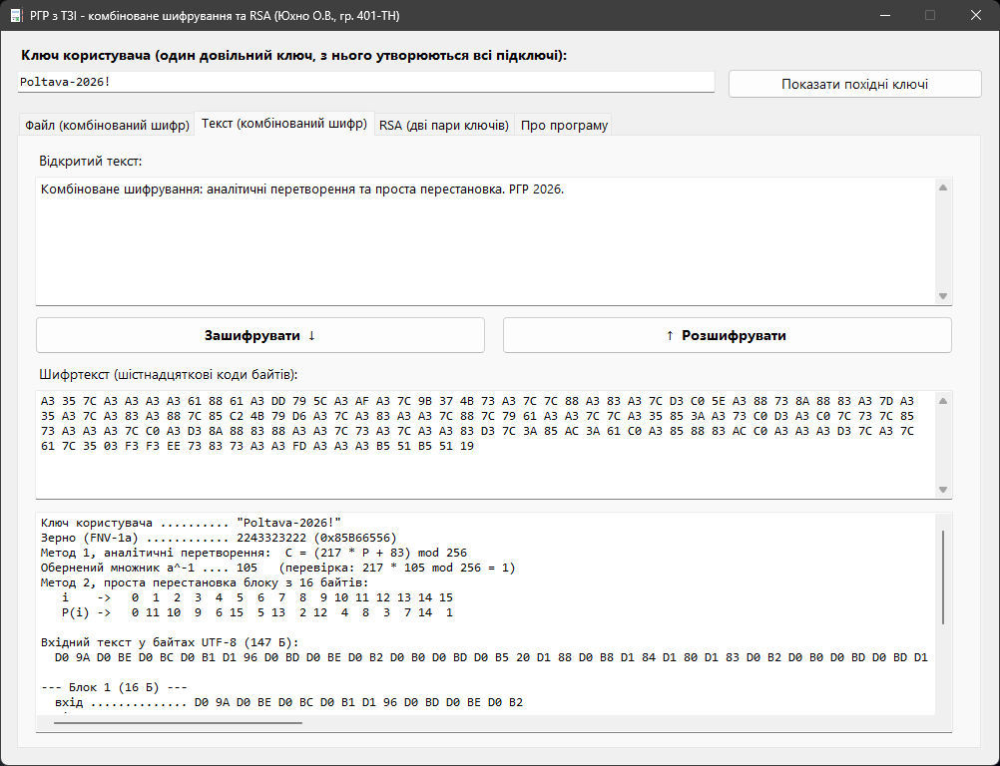
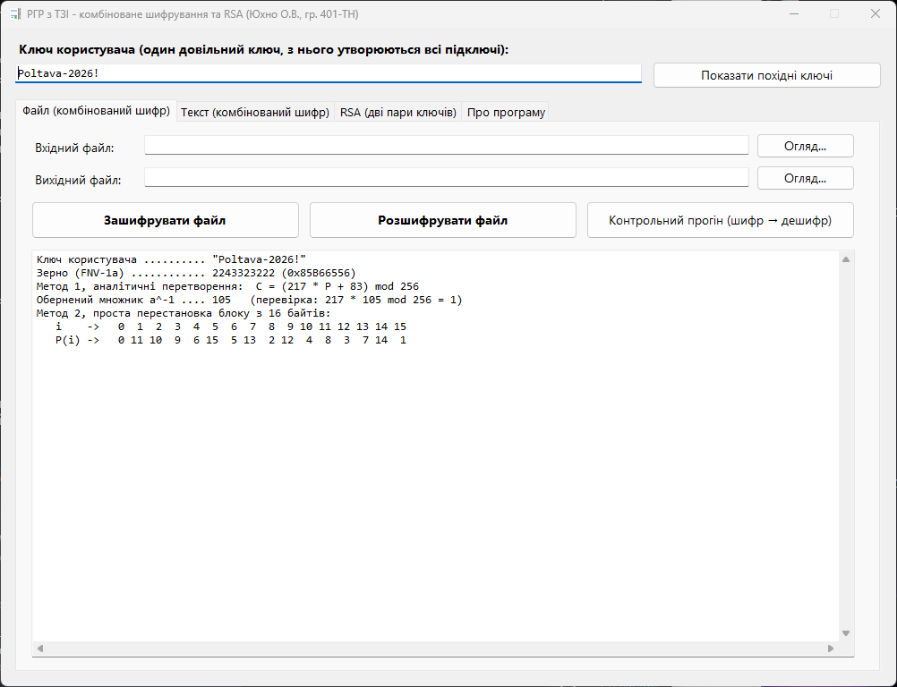
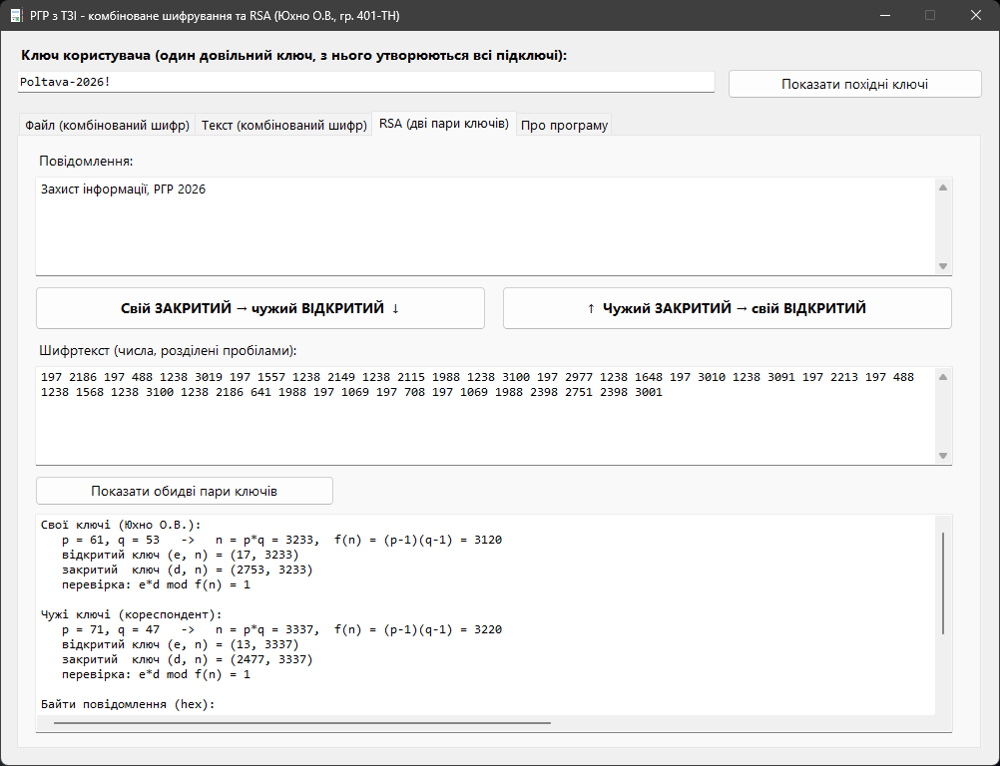

# TZI Crypto

Десктопна програма для Windows, яка шифрує файли й тексти комбінованим симетричним шифром (афінне перетворення + перестановка) і показує роботу RSA з двома парами ключів. Програма виводить усі проміжні обчислення, тому добре підходить для навчання та демонстрації.


<p align="center">
  
</p>

## Можливості

- **Шифрування файлів будь-якого типу** — `.txt`, `.exe`, зображення тощо. Розмір файлу після шифрування не змінюється.
- **Шифрування тексту** з виведенням шифртексту в шістнадцятковому вигляді.
- **Один ключ користувача** — з довільного рядка детерміновано виводяться всі підключі.
- **Контрольний прогін** — файл шифрується, розшифровується і звіряється з оригіналом.
- **RSA з двома парами ключів** — подвійне перетворення: свій закритий → чужий відкритий і навпаки.
- **Покрокове трасування** — для перших блоків видно стан даних після кожного етапу.

## Як це працює

### Комбінований шифр

Дані обробляються блоками по 16 байт. Кожен блок проходить два етапи:

1. **Афінне перетворення** кожного байта:
   `C = (a · P + b) mod 256`, де `a` — непарне (тоді існує `a⁻¹ mod 256`).
2. **Перестановка** байтів усередині блоку за таблицею `P(i)`.
   Останній неповний блок переставляється без доповнення, тому розмір файлу зберігається.

Розшифрування виконує ті самі етапи у зворотному порядку.

**Виведення ключів:**

```
ключ користувача ──FNV-1a──▶ 32-бітне зерно ──xorshift32──▶ a, b, таблиця перестановки (Фішер–Єйтс)
```

### RSA

Програма має дві пари ключів, свою та кореспондента. Числа навмисно малі, щоб усі обчислення було видно вручну:

| Пара      | p  | q  | n    | e  | d    |
|-----------|----|----|------|----|------|
| Своя      | 61 | 53 | 3233 | 17 | 2753 |
| Чужа      | 71 | 47 | 3337 | 13 | 2477 |

Шифрування: `C = (Mᵈ¹ mod n₁)ᵉ² mod n₂`, тобто спочатку своїм закритим ключем (підпис), потім чужим відкритим (конфіденційність). Розшифрування виконується у зворотному порядку. Умова `n₁ < n₂` гарантує, що ланцюжок перетворень оборотний.

> ⚠️ Проєкт навчальний. Афінний шифр і RSA з такими модулями не забезпечують реальної криптостійкості й не підходять для захисту справжніх даних.

## Скріншоти

| Файл | RSA |
|:----:|:---:|
|  |  |

## Збирання

**Потрібно:** Windows, Visual Studio 2022 з робочим навантаженням *Desktop development with C++* і компонентом *C++/CLI support*, а також .NET Framework 4.7.2.

1. Відкрити `TziCrypto.sln`.
2. Вибрати конфігурацію `Release | x64`.
3. Build → Build Solution (`Ctrl+Shift+B`).

Або з командного рядка (Developer Command Prompt):

```bat
msbuild TziCrypto.sln /p:Configuration=Release /p:Platform=x64
```

Готовий файл: `x64\Release\TziCrypto.exe`.

## Структура

```
src/
├── crypto_core.h   # ядро: теорія чисел, виведення ключів, обидва шифри, RSA (чистий C++, без .NET)
├── func.h          # прошарок між ядром та інтерфейсом
├── Source.cpp      # реалізація прошарку: String^ ⇄ UTF-8, журнал операцій
├── MainForm.h      # вікно програми (Windows Forms)
└── MainForm.cpp    # точка входу
```

`crypto_core.h` не залежить від .NET, тому його можна підключити до звичайного C++-проєкту й тестувати окремо від інтерфейсу.

## Автор

Юхно О.В., група 401-ТН, НУ «Полтавська політехніка імені Юрія Кондратюка».
Розрахунково-графічна робота з дисципліни «Технології захисту інформації».
